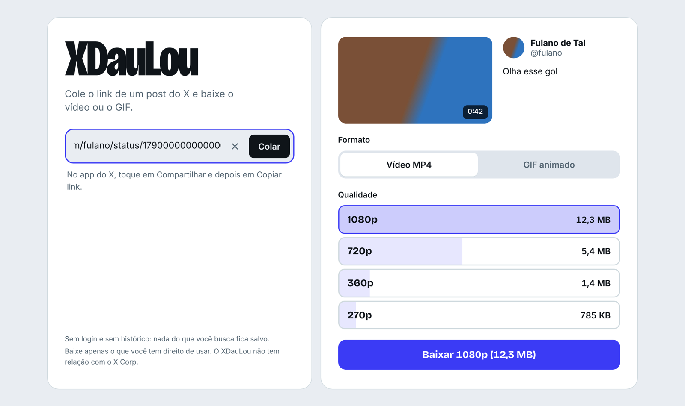
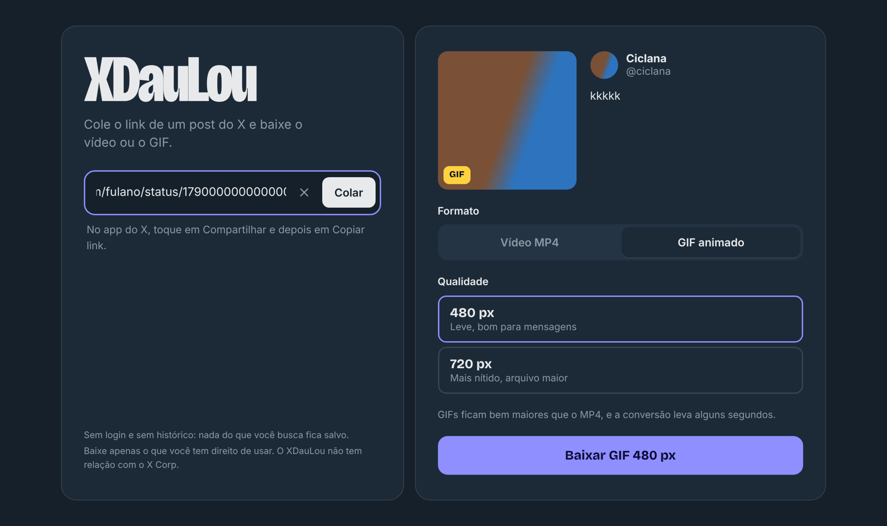
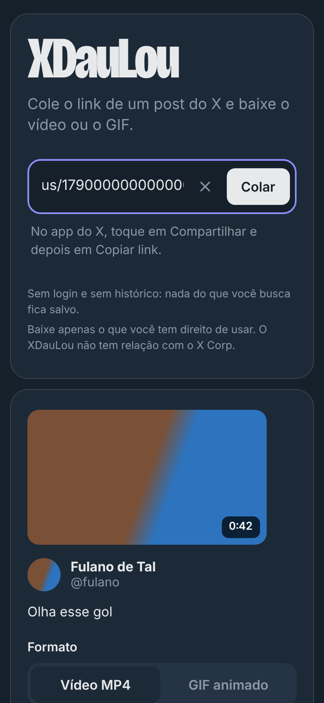

# XDauLou

**Baixe vídeos e GIFs de posts do X (Twitter) colando o link.** Uma tela só, sem login, sem anúncios e sem histórico.



<p align="center">
  
  &nbsp;
  
</p>

> As capturas usam o modo demonstração (`npm run demo`), com posts e miniaturas simulados.

## Funcionalidades

- **Um campo, qualquer link.** Aceita `x.com`, `twitter.com`, `mobile.twitter.com` e espelhos como `fxtwitter.com`, com ou sem parâmetros de rastreamento (`?s=20&t=...`). Também encontra o link no meio de um texto colado.
- **Busca automática.** Colou um link válido, a busca começa sozinha. O botão **Colar** lê a área de transferência.
- **Pré-visualização compacta.** Miniatura quadrada para GIF e retangular para vídeo, com duração, nome e @ do autor e o texto do post.
- **Qualidade com tamanho real.** Lista as resoluções disponíveis (1080p, 720p, 480p…) com o tamanho de cada arquivo em MB, e uma barra mostra quanto cada opção pesa em relação à maior.
- **GIF de verdade.** O X guarda GIFs como MP4 em loop. O XDauLou oferece o MP4 original (leve) ou converte para `.gif` real com ffmpeg, usando paleta otimizada.
- **Download direto.** O arquivo é salvo na hora, sem abrir nova aba nem player, com nome padronizado: `XDauLou_<número do post>_<qualidade>.mp4`.
- **Posts com vários vídeos.** Seletor de mídia; links `/video/2` já abrem a segunda.
- **Post citado.** Se o post só cita outro post com vídeo, oferece o vídeo citado.
- **Mobile-first, tema claro e escuro** seguindo o sistema operacional.
- **Compartilhar direto para o app** (Android, quando instalado como PWA) ou abrir `/?url=<link>`.

## Privacidade

- Não há login, cookies nem banco de dados.
- Não existe log de requisições. A busca é enviada por `POST`, para o link não aparecer em URLs, históricos ou logs de proxies.
- Cache e rate limit guardam apenas *hashes* com um sal aleatório gerado a cada inicialização. Nenhum link ou IP é armazenado em claro, e tudo expira em minutos.
- Miniaturas e arquivos passam pelo servidor: o navegador de quem usa nunca se conecta ao X.

## Segurança

- **Sem proxy aberto.** O servidor só baixa de `https://video.twimg.com` e `https://pbs.twimg.com`, e só com links que ele mesmo assinou (HMAC-SHA256) ao responder `/api/extract`. Os links expiram em 2 horas, o que também impede outros sites de embutirem downloads apontando para o seu servidor.
- **Redirecionamentos validados a cada salto**, antes de o servidor segui-los (proteção contra SSRF).
- **Rate limit por IP**, com IPv6 agrupado por /64 para não ser contornado trocando de endereço.
- **Conversão em GIF limitada:** tamanho de entrada e de saída, duração, conversões simultâneas e tempo máximo. Se o usuário fechar a página, o ffmpeg é encerrado na hora.
- **Cabeçalhos rígidos:** Content-Security-Policy sem scripts nem estilos inline, `Referrer-Policy: no-referrer`, `X-Frame-Options: DENY` e `nosniff`. Miniaturas só são servidas se forem JPEG, PNG, WebP ou GIF.
- **Nomes de arquivo higienizados** no `Content-Disposition` e todo texto vindo do X escapado antes de ir para a página.

## Como funciona

```
navegador ── POST /api/extract ──▶ servidor ──▶ cdn.syndication.twimg.com  (endpoint público dos embeds)
                                       │          └─ se falhar: yt-dlp (opcional, detectado automaticamente)
                                       ├─ cache de metadados (memória ou Redis)
                                       └─ HEAD em cada MP4 para descobrir o tamanho real

navegador ── GET /api/download ──▶ servidor ── stream ──▶ video.twimg.com    (Content-Disposition: attachment)
navegador ── GET /api/gif ───────▶ servidor ── ffmpeg ──▶ .gif real
navegador ── GET /api/thumb ─────▶ servidor ──────────▶ pbs.twimg.com
```

O proxy só aceita `https` nos hosts do X (`video.twimg.com`, `pbs.twimg.com`), então não pode ser usado como proxy aberto.

## Começando

Requisitos: **Node.js 22.9+** e, para GIFs, **ffmpeg** (o pacote `ffmpeg-static` é instalado junto; se não funcionar no seu sistema, use `brew install ffmpeg` ou `apt install ffmpeg`).

```bash
git clone https://github.com/franklinarauj/XDauLou.git
cd XDauLou
npm install
npm start
```

Abra <http://localhost:3000> e cole o link de um post.

| Comando | O que faz |
|---|---|
| `npm start` | Sobe o servidor (lê o `.env`, se existir) |
| `npm run dev` | Igual, reiniciando ao salvar arquivos |
| `npm run demo` | Sobe com um X simulado, sem internet. Útil para mexer na interface |
| `npm test` | Roda os testes automatizados |

## Configuração

Copie `.env.example` para `.env`. Todas as variáveis são opcionais.

| Variável | Padrão | Para quê |
|---|---|---|
| `PORT` | `3000` | Porta HTTP |
| `REDIS_URL` | vazio | Usa Redis para cache e rate limit (útil com mais de uma instância) |
| `CACHE_TTL_SECONDS` | `600` | Tempo de vida dos metadados em cache |
| `RATE_LIMIT_WINDOW_SECONDS` | `60` | Janela do rate limit |
| `RATE_LIMIT_EXTRACT` / `_DOWNLOAD` / `_GIF` | `30` / `30` / `6` | Requisições por IP por janela |
| `TRUST_PROXY` | `false` | Número de proxies na frente (ex.: `1` atrás de nginx/Cloudflare) para enxergar o IP real |
| `URL_SIGNING_SECRET` | aleatório | Segredo dos links assinados. Defina um valor fixo se rodar mais de uma instância |
| `SIGNED_URL_TTL_SECONDS` | `7200` | Validade dos links de download |
| `GIF_MAX_DURATION_SECONDS` | `60` | Vídeos mais longos não oferecem GIF |
| `GIF_MAX_INPUT_MB` | `80` | Tamanho máximo do MP4 a converter |
| `GIF_MAX_OUTPUT_MB` | `40` | Tamanho máximo do GIF gerado |
| `GIF_MAX_CONCURRENT` | `2` | Conversões simultâneas |
| `FFMPEG_PATH` / `YTDLP_PATH` | automático | Caminho dos binários, se não estiverem no PATH |

## API

| Método e rota | Entrada | Resposta |
|---|---|---|
| `POST /api/extract` | `{ "url": "<link do post>" }` | Autor, texto e mídias com variantes (`label`, `width`, `height`, `sizeBytes`, `url`, `exp`, `sig`) |
| `GET /api/download` | `src`, `exp`, `sig` (da variante), `name` | MP4 como anexo |
| `GET /api/gif` | `src`, `exp`, `sig`, `q` (`sd` = 480 px, `hd` = 720 px), `name` | GIF como anexo |
| `GET /api/thumb` | caminho assinado já devolvido em `thumbnail` e `avatar` | Imagem |
| `GET /api/health` | | Estado do cache, extratores e ffmpeg |

Erros sempre vêm como `{ "error": { "code", "message" } }`, com mensagens em português (`PRIVATE`, `NOT_FOUND`, `NO_MEDIA`, `RATE_LIMITED`…).

## Estrutura

```
public/                 interface (HTML, CSS e JS puros, sem build)
  js/tweet-url.js       parser de links, usado também pelo servidor
server/
  app.js                rotas, cabeçalhos de segurança e tratamento de erros
  extractors/           syndication (principal), yt-dlp (alternativo) e cache
  proxy.js              stream de download e miniaturas
  signer.js             assinatura dos links de mídia
  gif.js                conversão com ffmpeg
  stores.js             cache e contadores (memória ou Redis)
  rate-limit.js         limite por IP
test/                   testes (node:test) e o X simulado
scripts/demo.js         modo demonstração
```

## Testes

```bash
npm test
```

São 38 testes cobrindo o parser de links, a normalização das respostas do X (vídeo, GIF, conta privada, conteúdo sensível, só fotos, post citado), o cache, o rate limit, os links assinados, os redirecionamentos e a conversão real de MP4 em GIF. Eles rodam automaticamente no GitHub Actions a cada push.

## Publicação

O XDauLou precisa de um servidor Node.js (para falar com o X e converter GIFs), então não roda em hospedagens só estáticas como o GitHub Pages. Há um `Dockerfile` pronto:

```bash
docker build -t xdaulou .
docker run -p 3000:3000 xdaulou
```

## Limitações

- O endpoint de syndication é público, mas não documentado; o X pode mudá-lo. Se o `yt-dlp` estiver instalado, ele entra automaticamente como alternativa.
- Posts de contas privadas e com conteúdo sensível exigem login no X e não podem ser baixados.

## Aviso

Baixe apenas conteúdo que você tem direito de usar. O XDauLou é um projeto independente e não tem relação com o X Corp.

## Licença

[MIT](LICENSE). A fonte Bricolage Grotesque, em `public/fonts/`, é distribuída sob a [SIL Open Font License](public/fonts/OFL.txt).
